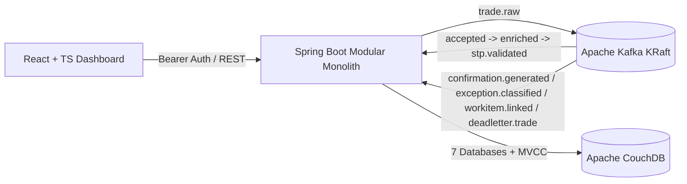

# Trade Confirmation Exception Management Platform

An event-driven educational financial technology platform that processes **synthetic** trade events through Apache Kafka, enriches and validates them against reference data in Apache CouchDB, generates structured trade confirmations, classifies exceptions, tracks remediation work items, persists and replays dead-letter messages, and exposes an institutional React + TypeScript operational dashboard secured by role-based access control.

> **Educational Project:** Synthetic trade confirmation & exception management platform for educational demonstration only. Not a production financial-market integration; confirmations are not legally binding.

## End-to-End Architecture


## Architecture & Modules
Modular monolith (`com.tradeexception.platform`):
1. `ingestion` — `SyntheticTradeProducer`, `TradeIngestionConsumer`, `TradeIngestionService`, `SyntheticTradeController`
2. `trade` — FpML-inspired `Trade` domain model, `TradeRepository`, `TradeController`
3. `enrichment` — `ReferenceDataSeeder`, `TradeEnrichmentConsumer`, `TradeEnrichmentService`
4. `stp` — 8 modular `StpValidationRule`s, `StpRuleEngine`, `StpValidationConsumer`, `StpValidationService`
5. `confirmation` — `ConfirmationTemplateRenderer`, `ConfirmationGenerationConsumer`, `ConfirmationGenerationService`, `ConfirmationController`
6. `exception` & `classification` — `ExceptionClassifier` (rule-based), `ExceptionClassificationConsumer`, `ExceptionClassificationService`, `ExceptionController`
7. `workitem` — `TeamRoutingStrategy`, `WorkItemManagementConsumer`, `WorkItemManagementService`, `WorkItemController`
8. `audit` — append-only `AuditEventRepository`, read-only `AuditController`
9. `replay` — `DeadLetterPublisher`, `DeadLetterConsumer`, `DeadLetterRepository`, `DeadLetterManagementService`, `DeadLetterController`
10. `security` — Spring Security (`ADMIN`, `OPERATIONS`, `VIEWER`), `BCryptPasswordEncoder`, `HmacTokenService`, `AuthController`
11. `dashboard` — `DashboardSummaryService`, `DashboardController`

## Technology Stack
- **Backend:** Java 21, Spring Boot 3.3.5, Maven Wrapper (`mvnw`), Spring Web, Validation, Security, Kafka, Actuator
- **Frontend:** React 18, TypeScript 5.6, Vite 8, Tailwind CSS 3.4, React Router 7, Vitest 5
- **Messaging & Storage:** Apache Kafka 3.8.1 (KRaft), Apache CouchDB 3.3.3 (7 databases: `trades`, `confirmations`, `exceptions`, `work-items`, `audit-events`, `reference-data`, `dead-letters`)
- **Infrastructure & API Tooling:** Docker, Docker Compose, Postman (`postman/Trade-Exception-Platform.postman_collection.json`)

## Documentation
- [System Architecture](docs/architecture/system-architecture.md)
- [Kafka Event Design](docs/architecture/kafka-event-design.md)
- [Database Design](docs/architecture/database-design.md)
- [REST API Reference](docs/api/api-reference.md)
- [Development Roadmap](docs/architecture/development-roadmap.md)
- [Demonstration Guide](docs/DEMONSTRATION-GUIDE.md)

## Environment Variables
Copy `.env.example` → `.env` (never commit `.env`):
- **CouchDB:** `COUCHDB_USER`, `COUCHDB_PASSWORD`, `COUCHDB_URL`, `COUCHDB_AUTO_INITIALIZE`, `COUCHDB_INIT_FAIL_FAST`
- **Kafka:** `KAFKA_BOOTSTRAP_SERVERS`, `KAFKA_CLUSTER_ID`
- **Security (required for authenticated endpoints):** `APP_AUTH_SECRET`, `APP_SECURITY_ADMIN_USER`, `APP_SECURITY_ADMIN_PASSWORD`, `APP_SECURITY_OPS_USER`, `APP_SECURITY_OPS_PASSWORD`, `APP_SECURITY_VIEWER_USER`, `APP_SECURITY_VIEWER_PASSWORD`
- **CORS & Frontend:** `CORS_ALLOWED_ORIGINS` (backend), `VITE_API_BASE_URL` (in `frontend/.env`)

## Local Development & Testing
```bash
# Backend build & tests (Maven Wrapper)
cd backend && .\mvnw.cmd verify          # Linux/macOS: ./mvnw verify
.\mvnw.cmd spring-boot:run

# Frontend tests, security audit & production build
cd frontend && npm install
npm test && npm run build && npm audit
npm run dev
```

## Docker Compose Verification Commands
Once Docker Desktop is running:
```bash
cp .env.example .env                     # fill in all CHANGE_ME values
docker-compose config -q
docker-compose up --build -d
docker-compose ps                        # verify kafka, couchdb, backend healthy
curl -fsS http://localhost:8080/api/v1/health
curl -fsS http://localhost:8080/actuator/health
# Stop after verification:
docker-compose down
```

## Postman Collection
Import [Trade-Exception-Platform.postman_collection.json](postman/Trade-Exception-Platform.postman_collection.json):
1. Set `baseUrl` (default `http://localhost:8080`).
2. Run **1. Authentication - Login** with your configured `operations` or `admin` credentials (automatically stores `accessToken`).
3. Execute trade, confirmation, exception, work-item, audit, and DLQ replay requests.

## DLQ & Replay Atomicity & `IN_PROGRESS` Recovery
Kafka publication and CouchDB status updates are **not** a single atomic transaction. Before publishing, `DeadLetterManagementService` transitions the DLQ record to `IN_PROGRESS` using CouchDB MVCC `_rev` to block concurrent duplicate replays.
- **Partial-failure recovery:** If Kafka publish succeeds and the final CouchDB update fails, the DLQ record remains `IN_PROGRESS`. Operators should inspect `GET /api/v1/audit-events?correlationId=<corrId>` and `GET /api/v1/trades/<tradeId>` to confirm whether downstream processing succeeded; never silently mark an unverified `IN_PROGRESS` record as `REPLAYED`.

## Synthetic Trade Scenarios (`POST /api/v1/synthetic-trades/{scenario}`)
`VALID_FX_SPOT` · `VALID_FX_FORWARD` · `MISSING_MANDATORY_ECONOMIC_FIELD` · `INVALID_COUNTERPARTY_REFERENCE` · `DUPLICATE_MESSAGE` · `MALFORMED_PAYLOAD`

## Troubleshooting
- **401 Unauthorized in Dashboard:** Click **Sign in** in the header and authenticate with credentials set in `APP_SECURITY_OPS_PASSWORD` / `APP_SECURITY_ADMIN_PASSWORD`.
- **Docker Compose fails to start:** Ensure Docker Desktop is running and `.env` has no remaining `CHANGE_ME` placeholders (`KAFKA_CLUSTER_ID`, `COUCHDB_PASSWORD`, `APP_SECURITY_*_PASSWORD`).
- **Backend tests fail inside restricted sandbox:** Run `.\mvnw.cmd verify` in a normal terminal with access to `~/.m2` and localhost ephemeral ports for Embedded Kafka.
