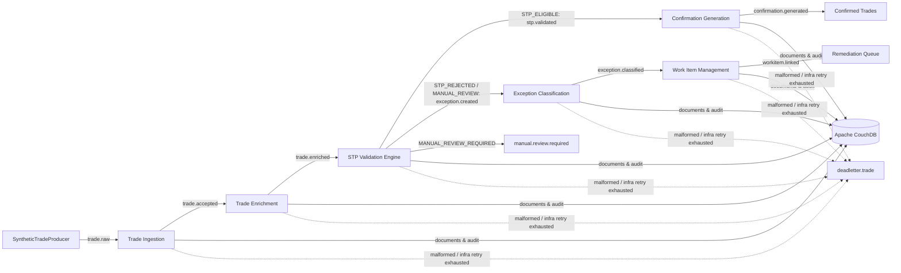

# System Architecture

> **Current State (Phase 5):** Full backend event-driven workflow is implemented — Trade Ingestion, Reference Data Seeding, Trade Enrichment, STP Validation, Confirmation Generation, Exception Classification, Work Item Management, Append-Only Audit Trail, and Dead-Letter Handling. REST operational query/remediation APIs and Frontend dashboard integration remain for Phase 6.

## End-to-End Event-Driven Architecture

## Implemented Backend Modules (Phases 1–5)

1. **Trade Ingestion (`ingestion`)**: consumes `trade.raw`, validates envelope & `Trade`, persists `ACCEPTED`, records `TRADE_ACCEPTED`, publishes `trade.accepted`.
2. **Reference Data & Trade Enrichment (`enrichment`)**: idempotently seeds synthetic reference data; consumes `trade.accepted`, enriches with field-level provenance (`SUPPLIED`/`DERIVED`/`DEFAULTED`), publishes `trade.enriched`.
3. **STP Validation Engine (`stp`)**: evaluates 8 modular deterministic `StpValidationRule`s into `STP_ELIGIBLE`, `STP_REJECTED`, or `MANUAL_REVIEW_REQUIRED`; routes to `stp.validated` or persists initial `ExceptionRecord` and publishes `exception.created` (+ `manual.review.required`).
4. **Confirmation Generation (`confirmation`)**: consumes `stp.validated`, loads `Trade` + counterparty/product/template reference data, renders a readable non-legally-binding HTML confirmation via `ConfirmationTemplateRenderer`, persists `Confirmation` (`CNF-<tradeId>`), transitions `Trade` to `CONFIRMED`, records `CONFIRMATION_GENERATED`, and publishes `confirmation.generated`. Missing templates route to `exception.created`.
5. **Exception Classification (`classification`)**: consumes `exception.created`, applies deterministic rule-based classification (`ExceptionClassifier`) to assign category, root cause, priority, severity, explanation, and remediation action, updates `ExceptionRecord` while preserving original fields, records `EXCEPTION_CLASSIFIED`, and publishes `exception.classified`.
6. **Work Item Management (`workitem`)**: consumes `exception.classified`, creates deterministic `WorkItem` (`WI-<exceptionId>`), routes to synthetic operational teams (`TRADE_OPERATIONS`, `COUNTERPARTY_OPERATIONS`, `PRODUCT_CONTROL`, `CONFIRMATION_OPERATIONS`), sets priority-based SLA due dates, publishes `workitem.linked`, and enforces audited lifecycle transitions (`OPEN` → `IN_PROGRESS` / `PENDING` → `RESOLVED` → `CLOSED`).
7. **Audit Management (`audit`)**: append-only `AuditEventRepository` capturing entity-scoped events across all stages.
8. **Dead-Letter Handling (`replay`)**: routes malformed payloads and retry-exhausted technical failures to `deadletter.trade` with diagnostic headers.
