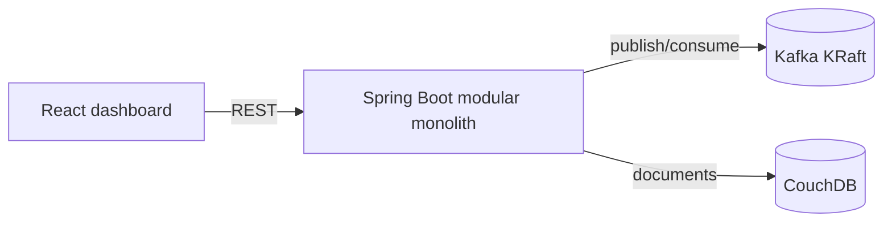

# System Architecture

> Describes target design. In Phase 1 only the skeleton exists (see "Current state").

## High-level architecture

## Backend responsibilities
Ten modules, each its own package: Trade Ingestion, Trade Management, Trade Enrichment, STP Validation, Confirmation Management, Exception Management, Exception Classification, Work Item Management, Audit Management, Replay & DLQ. Layering inside a module: `api` (controllers) → `service` (business logic) → `repository`/`messaging` (infrastructure). Business logic never depends on controllers or Kafka/CouchDB classes directly.

Cross-cutting (`common`): `ApiResponse` envelope and `GlobalExceptionHandler`.

## Frontend responsibilities
Presentation of trades, exceptions, manual review, work items and audit trail; remediation actions; dashboards. Talks to the backend REST API only.

## Kafka responsibilities
Asynchronous, decoupled stage-to-stage communication, ordering per trade (keyed by tradeId), retry and dead-letter routing. See [kafka-event-design.md](kafka-event-design.md).

## CouchDB responsibilities
Document persistence for trades, confirmations, exceptions, work items, audit events and reference data. See [database-design.md](database-design.md).

## Event-driven processing overview (planned)
raw trade → accepted → enriched → STP validated → confirmation generated, **or** exception created → classified → work item linked / manual review. Failures go to `deadletter.trade`.

## Component interactions
Modules interact only through Kafka events and published module APIs; each stage emits an audit event.

## Current state (Phase 1)
Implemented: Spring Boot app, health endpoint, Actuator, exception handler, response envelope, React shell with placeholder pages, Docker Compose. Not implemented: everything else above.
